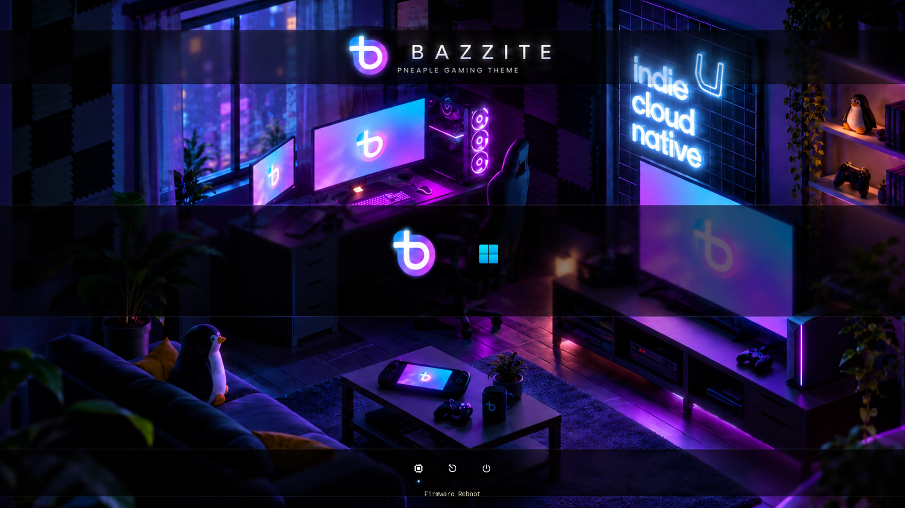

# RefindPlus Bazzite Pneaple

A separate RefindPlus adaptation of [rEFInd Bazzite Pneaple](https://github.com/zany130/rEFInd-bazzite-pneaple), with the real EFI tools row positioned near the bottom, inspired by the original concept. The 4K wallpaper is restored from source-theme commit `13644ec`, bringing back the narrower middle band and dark bottom band. The current Shadow icons and glowing-dot selection graphics are retained.

**Requires the experimental `tool_row_tune` build:** [zany130/RefindPlus, feature/tool-row-tune](https://github.com/zany130/RefindPlus/tree/feature/tool-row-tune), tested commit `31cee4c00c2b98ce731e79bb635934884fe20ec9`. [Release/debug build artifacts](https://github.com/zany130/RefindPlus/actions/runs/38934290203). Stock rEFInd and RefindPlus builds without that feature cannot move the tools this way. This theme does not include an EFI binary.



The screenshot uses labeled Bazzite/Windows **VM layout placeholders**, not installed operating systems. Firmware, Reboot and Shutdown are actual RefindPlus tools. Their availability depends on firmware support. No artificial Rescue Tools entry is created.

## What changed

- New theme directory: `themes/RefindPlus-bazzite-pneaple/`.
- `tool_row_tune -10000` deliberately requests more downward travel than needed; the patched boot manager clamps the tools to the lowest safe position while leaving room for the shared label and timeout. This tests the feature's lower-bound behavior across resolutions.
- OS icons retain their normal centered position. Hints are hidden for the cleaner concept-inspired footer layout.
- Explicit 1080p sizes with `scale_ui 99` avoid RefindPlus's automatic HiDPI enlargement. The optional 4K profile doubles the icon sizes.
- A separate example enables the three real tools. The theme itself does not change boot entries, scanning, tools, loaders, timeout, Secure Boot or firmware settings.

RefindPlus displays **one selected-item label**, including when an OS entry is selected. That shared label follows the tools to the bottom. Independent captions below every icon, as drawn in the concept, are not supported by this feature. The narrower middle band and bottom band are restored byte-for-byte from the earlier artwork; the tools now sit over the restored bottom band.

## Native RefindPlus exit splash


`icons/boot_outlogo.png` reuses the theme's transparent blue-purple Bazzite emblem byte-for-byte. RefindPlus loads this from the configured `icons_dir` and centers it before supported graphical OS launches. It takes precedence over the per-OS boot logos, so eligible Windows launches also show the theme emblem.

The theme enables exit images with `disable_exitlogo_image OFF` and keeps them visible until the next loader redraws the screen with `disable_exitlogo_clear`. Native scaling remains enabled. The existing menu icon, wallpaper and selection graphics are unchanged.

**Loader limitation:** RefindPlus's exit-logo path applies to graphical Linux-stub (`L`) and Windows (`W`) entries, not every EFI application. Text/verbose launches, GRUB and an unclassified Shim entry may bypass it. This is a boot-manager splash, not a replacement for Plymouth, Windows startup graphics or a firmware BGRT. The theme does not change loader paths, force a Shim entry to another OS type, or change your trusted boot chain.

For a supported manual entry, `graphics on` enables graphical handoff; add it to that entry in your main configuration if desired. Keep its existing loader, volume and OS classification intact. Do not replace a working Shim loader just to obtain a splash. A following loader can clear the image immediately after handoff.

Verified at 1920×1080 in QEMU/OVMF using patched RefindPlus `bf0be4c`: a temporary manual entry marked `ostype Windows` with `graphics on` launched a copy of the boot manager solely to exercise the native exit path. The screenshot was captured during that handoff. No real OS or host disk was attached; this verifies rendering, not a Windows boot or the live Bazzite/Shim handoff. The PNG was decoded successfully and checked byte-for-byte against the existing emblem.

To disable the splash, add `disable_exitlogo_image ALL` **after** the theme include in your main configuration.

## Try it on Bazzite without changing your boot installation

Use an existing QEMU/OVMF installation and a downloaded **patched x64 RefindPlus Release binary**. From this repository:

```sh
python3 scripts/preview.py --efi /absolute/path/to/x64_RefindPlus_REL.efi
```

Close the VM window when finished. It attaches only temporary files, has no network or host disks, and uses a disposable firmware-variable file. Do not launch the placeholder OS entries. The preview does not test your actual Bazzite boot chain.

For a zero-offset comparison and an optional 4K attempt:

```sh
python3 scripts/preview.py --efi /absolute/path/to/x64_RefindPlus_REL.efi --resolution 3840x2160
python3 scripts/preview.py --efi /absolute/path/to/x64_RefindPlus_REL.efi --baseline
```

**4K status:** The profile is prepared but not visually verified: the available OVMF/QEMU setup did not retain a 3840×2160 framebuffer. Verify it on compatible firmware before relying on the 4K layout. Headless capture rejects a mismatched framebuffer instead of treating it as a passed test.

For reproducible headless screenshots, add `--capture /absolute/path/to/captures` (requires Pillow). Captures include both OS selection and tool selection. Use Left/Right/Down/Up in the interactive VM to confirm that the glowing selection marker follows the selected tool. Avoid executing Firmware/Reboot/Shutdown while comparing layouts.

## Use with an existing RefindPlus installation

This is a theme, not a bootloader installer. First test the patched binary through your existing trusted setup. The CI binary is unsigned: it must not replace a trusted bootloader on a Secure Boot system without the appropriate existing signing/trust procedure. Keep Fedora Shim, the working Shim → GRUB chain, firmware keys and boot order intact.

1. Back up your existing RefindPlus `config.conf` outside the ESP.
2. Copy only `background.png`, `theme.conf`, `selection_big.png`, `selection_small.png`, `icons/` and `profiles/` into a **new** `themes/RefindPlus-bazzite-pneaple/` directory alongside that RefindPlus binary. Do not overwrite the original rEFInd theme.
3. In your existing main `config.conf`, replace its active theme include with:

   ```text
   include themes/RefindPlus-bazzite-pneaple/theme.conf
   showtools firmware,reboot,shutdown
   ```

   `showtools` changes the visible tool list; retain any other utilities you want by adding them to that list. Firmware only appears when supported.

4. At 3840×2160, add this **after** the theme include in the main config:

   ```text
   include themes/RefindPlus-bazzite-pneaple/profiles/2160p.conf
   ```

   Do not nest the profile include inside the theme: RefindPlus limits nested configuration includes. Resolution selection remains in your main config, not the theme.

5. Keep existing boot-entry volume, loader and options unchanged. If desired, update only their icon path to the appropriate file in the new theme directory. Keep Bazzite pointed to its already-working Shim chain.

To restore normal tools placement, add `tool_row_tune 0` after the theme include in the main config. To undo the theme, restore the prior theme include and tool list from your backup.

No live ESP, bootloader or Secure Boot changes are performed by the supplied preview script.

## Verification and limitations

See [TESTING.md](TESTING.md) for the exact binary, configurations and observed VM results. Physical firmware, your live Bazzite boot and the actual Secure Boot chain remain untested. The previous host QEMU 10.2.2 test runs occasionally exited with SIGSEGV; a VM process failure is not proof of an EFI layout failure, and persistent failures require separate diagnosis.

The historical `screenshots/preview.png` and `screenshots/concept-preview.png` came from the original rEFInd project. Only screenshots prefixed `refindplus-` show this adaptation.

## Credits and licenses

Source theme history is preserved from commit `a973082` of [zany130/rEFInd-bazzite-pneaple](https://github.com/zany130/rEFInd-bazzite-pneaple). This is a separate repository; it does not change that project.

Shadow-rEFInd icons retain their AGPL-3.0 license and original attribution. The wallpaper is the source theme's derivative of Bazzite Convergence artwork; its file-specific derivative/redistribution terms remain unverified as recorded by that project. The MIT project license does not relicense third-party artwork, graphics or trademarks. See [ATTRIBUTION.md](ATTRIBUTION.md), [LICENSE](LICENSE), and [third_party/Shadow-rEFInd-AGPL-3.0.txt](third_party/Shadow-rEFInd-AGPL-3.0.txt).
