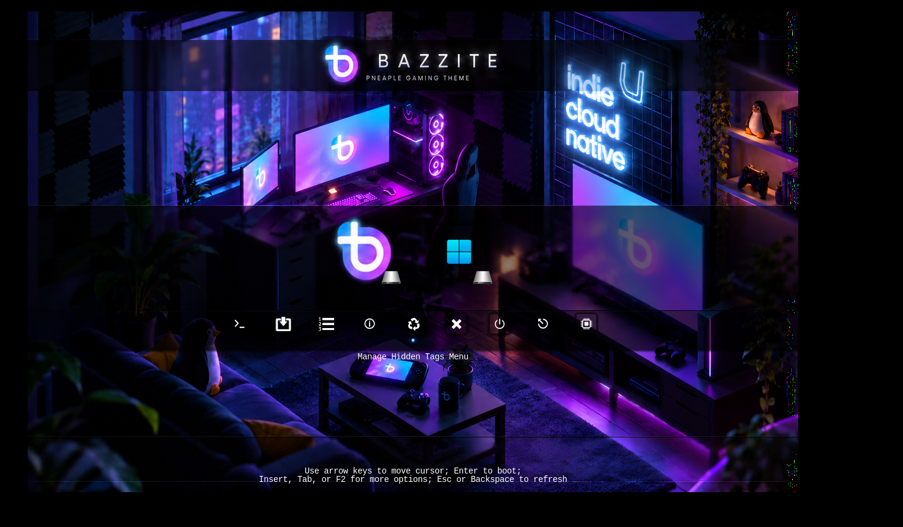

# rEFInd Bazzite Pneaple

A 4K neon-gaming-room rEFInd theme inspired by Pneaple’s translucent menu bands and built around Bazzite’s Convergence artwork, with a complete Shadow-rEFInd icon collection.

> **Status:** The real rEFInd menu has been **previewed in QEMU/OVMF** using the theme assets. A screenshot of that preview is below. The theme has **not been verified on physical UEFI hardware**, and QEMU placeholder boot entries do not establish that any operating system boots successfully.



## What this repository contains

- `background.png`: a 3840×2160 wallpaper with artwork and branding, but **no baked-in working boot-entry icons**.
- `theme.conf`: visual settings only (background, icons, selection graphics and icon sizes); no boot entries, EFI executables, or Secure Boot configuration.
- `icons/`: the complete original **Shadow-rEFInd** icon collection, plus a few clearly distinguished aliases and a custom Bazzite image. OS, tools, arrows, volume badges, and optional utilities are included; unused icons do **not** enable new tools.
- `selection_big.png` and `selection_small.png`: matching upstream Shadow-rEFInd selection images for **128px main-row** and **48px utility-row** icons.
- `screenshots/preview.png`: a **real rEFInd/QEMU screenshot**, not a mockup. `screenshots/concept-preview.png` is a historical design illustration, **not** a real boot-menu screenshot.
- `source/`: preserved concept/source imagery for future manual artwork changes. This repository does **not** currently ship a reproducible `scripts/build_assets.py` or `scripts/sync_shadow_icons.py` workflow.
- `third_party/Shadow-rEFInd-AGPL-3.0.txt`, `ATTRIBUTION.md`, and `LICENSE`: rights and provenance notices.

The wallpaper includes design-oriented translucent header, menu and footer bands; actual boot entries are rendered by rEFInd over them.

## Install on an existing working rEFInd setup

**This is a theme, not an rEFInd installer.** Never overwrite `refind.conf` wholesale or replace Shim, GRUB, signed EFI executables, Secure Boot keys, or firmware boot order. The commands below assume that your *existing* EFI System Partition is mounted at `/boot/efi` and rEFInd is installed at `/boot/efi/EFI/refind`. Adjust those locations for your machine.

1. Back up the **existing** rEFInd configuration *outside* the ESP:

   ```sh
   sudo cat /boot/efi/EFI/refind/refind.conf > "$HOME/refind.conf.before-rEFInd-bazzite-pneaple.bak"
   ```

2. Clone this repository into a normal working directory (not the ESP), then install **only the runtime theme assets**:

   ```sh
   git clone https://github.com/zany130/rEFInd-bazzite-pneaple.git
   cd rEFInd-bazzite-pneaple
   sudo mkdir -p /boot/efi/EFI/refind/themes/rEFInd-bazzite-pneaple
   sudo cp -a background.png theme.conf selection_big.png selection_small.png icons /boot/efi/EFI/refind/themes/rEFInd-bazzite-pneaple/
   ```

3. In your existing `/boot/efi/EFI/refind/refind.conf`, **replace the currently active theme include**, or add one if none exists. Keep only one active theme include:

   ```conf
   include themes/rEFInd-bazzite-pneaple/theme.conf
   ```

4. If you use an **existing, already-working manual Bazzite boot entry**, you may change **only** its icon directive:

   ```conf
   icon /EFI/refind/themes/rEFInd-bazzite-pneaple/icons/os_bazzite.png
   ```

   Leave that entry's `volume`, `loader`, options, and all other entries unchanged. On a Bazzite system using Shim for Secure Boot, **retain the already-working Shim → GRUB chain**, rather than pointing rEFInd directly to `grubx64.efi`.

5. Reboot to check the actual firmware rendering when convenient. To revert, restore your previous `include` and manual-entry icon directives (or the backup); leave your earlier theme directory in place until satisfied.

## Behavior and limitations

- The display uses stock rEFInd menu positioning: number of discovered OSes, UI alignment, available firmware resolution and font contrast can change its appearance. The screenshot depicts a **QEMU preview**, not a guarantee of physical firmware alignment.
- rEFInd generally displays the **selected** boot entry's label; the artistic mockups may depict multiple decorative labels simultaneously.
- The original Shadow icons are designed around **128px / 48px** display sizes. They may appear relatively small on a native 4K monitor.
- The theme uses the shared **custom Bazzite icon** (`icons/os_bazzite.png`). It does not bundle the old optional custom `os_shell.png` or `os_rescue.png` assets; do not assume those manually described entries exist.
- To enable or disable optional utilities, change the **main** `refind.conf` `showtools` setting, not the theme. For example, firmware setup/reboot/shutdown/Shell utilities appear only when supported and enabled. Icons alone do not create a valid EFI loader.

## Artwork, credits and redistribution

The published wallpaper is an **edited, composited and resampled derivative** of Bazzite’s official [Convergence wallpaper](https://github.com/ublue-os/bazzite/blob/main/press_kit/art/Convergence_Wallpaper.png), not the original file. The heading now reads **PNEAPLE GAMING THEME**, without the old “Concept” label.

The [Universal Blue artwork repository](https://github.com/ublue-os/artwork) is generally Apache-2.0 but cautions that individual wallpapers can have separate licenses. We have **not** independently verified the Convergence file's specific derivative/redistribution terms. Seek confirmation from the rights holder before treating this modified wallpaper as freely redistributable.

The icon collection and matching selections are from [chris1111/Shadow-rEFInd](https://github.com/chris1111/Shadow-rEFInd), pinned to commit `fe639d2869f59d291489c0c416c17577bd166046`; the imported upstream files are preserved unmodified. **Shadow-rEFInd is AGPL-3.0**, and the full license is included under `third_party/`. The repository's MIT license applies only to independently authored project material and **does not relicense Shadow-rEFInd assets, independently owned wallpaper source art or trademarks**.

Layout inspiration: [Pneaple Boot Theme](https://github.com/pineapplelite/Pneaple-Boot-Theme) by pineapplelite (MIT); secondary inspiration: [rEFInd Lumen](https://github.com/shoxjaxon-atabayev/rEFInd-lumen) and [BsxM1](https://github.com/AlexFullmoon/refind-bsxm1-theme). No source code or icon PNGs from those inspiration themes are claimed as part of this theme.

See [ATTRIBUTION.md](ATTRIBUTION.md) for the asset-level provenance and license qualifications. This is an **unofficial community theme**, not affiliated with or endorsed by Bazzite, Universal Blue, Microsoft or the source theme authors.

## Further information

- [Official rEFInd theming guide](https://www.rodsbooks.com/refind/themes.html)
- [Official rEFInd configuration reference](https://www.rodsbooks.com/refind/configfile.html)
- [Shadow-rEFInd icon source](https://github.com/chris1111/Shadow-rEFInd)
